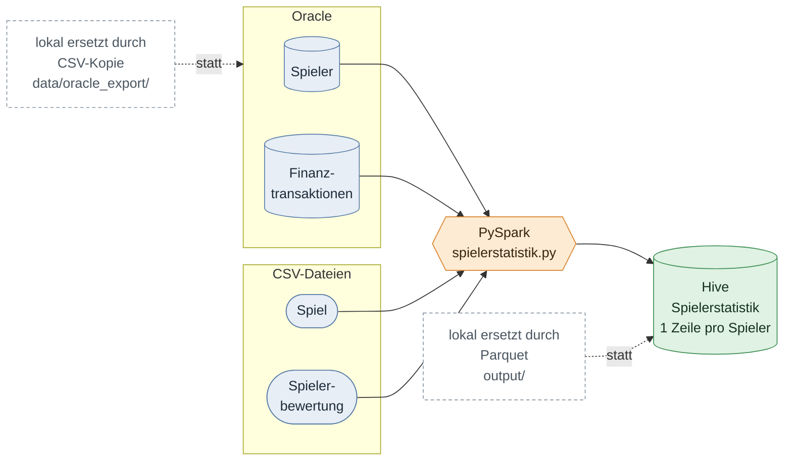
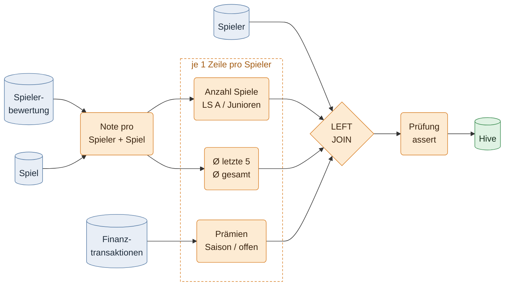

# DFB Spielerstatistik

Der DFB möchte in Hive eine Tabelle mit einer Zeile pro Spieler. Die Aufgabe erlaubt eine Auswahl an
Kennzahlen. Ich habe sieben gebaut: Anzahl Spiele, Länderspiele A und Junioren, Ø der letzten 5 Spiele und Ø gesamt,
Prämie der Saison und offene Prämien. Die beiden Durchschnitte zusammen zeigen, ob ein Spieler gerade in Form ist.



## Vorgehen

Zuerst habe ich das Datenmodell angeschaut. Ein Spieler steht einmal in der Spielertabelle, hat aber viele
Zahlungen und viele Bewertungen. Leon hat 5 Zahlungen und 17 Bewertungen. Joint man beides direkt an den
Spieler, entstehen 85 Zeilen und jede Summe ist 17-fach. Ich fasse deshalb erst pro Spieler zusammen und
joine danach.

Beispiel Prämien von Leon:

```
vorher, 5 Zeilen:
TX01  NM-Prämie   10.000  bezahlt    28.03.2026   Vorsaison
TX02  NM-Prämie   12.000  bezahlt    06.09.2026   zählt
TX03  Verein       3.000  offen                   raus
TX04  NM-Prämie    2.000  storniert               raus
TX05  Gehalt      50.000  bezahlt                 raus

nachher, 1 Zeile:
Leon  Prämie Saison 12.000   offen 0
```

Ohne diesen Schritt hinge jede Zahlung 17-mal am Spieler, einmal pro Bewertung. Aus 12.000 würden 204.000.

Dann habe ich gesammelt, was fehlt oder unklar ist, und mich jeweils entschieden. Die Aufgabe erlaubt eine
Auswahl. Ich habe mich auf sieben beschränkt, und zwar auf die, die ein Trainer für Form und Potenzial braucht.

## Annahmen

Mit dem Fachbereich zu klären:

| Frage | Meine Annahme |
|---|---|
| Was ist eine Prämie? | Nur Nationalmannschaft, kein Gehalt |
| Welche Status zählen? | bezahlt und offen |
| Zeitraum bei „ausstehend“? | alle offenen Prämien, egal aus welcher Saison |
| Was sind Junioren? | alles außer „A“ |
| Welche Saison? | 2026/27, fest im Skript |
| Zählen Vereinsspiele? | ja, bei „letzte 5“ |

Mit der IT zu klären, weil Daten fehlen:

| Was fehlt | Meine Annahme |
|---|---|
| Einsatzdaten | Wer eine Note hat, hat gespielt |
| Saison bei Zahlungen | Zahlungsdatum, 01.07. bis 30.06. |
| Teilzahlungen | als zwei Zeilen gebucht (bezahlt + offen). Ein Status wie „teilbezahlt“ fiele raus |
| Uhrzeit beim Spiel | gleicher Tag: höhere Spiel_ID ist später |
| Tore, Karten | weggelassen, keine Kennzahl braucht sie |
| aktuelles Alter | nicht genutzt, veraltet |
| Währung | alles Euro |

Selbst entschieden:

| Thema | Entscheidung |
|---|---|
| Oracle lokal | CSV-Kopien in `data/oracle_export/` |
| Oracle-Schema | `DFB` |
| Tabelle Nationalmannschaft | nicht gelesen, Kategorie steht im Spiel |
| Datenschutz | von Spielern nur die ID laden, keine Telefonnummer, kein Wohnort (auch Minderjährige) |
| Speichern | jeder Lauf überschreibt |

## Ablauf



Pro Spiel mittle ich zuerst über die Bewerter, sonst zählt ein Spiel mit drei Bewertern dreimal.
Der LEFT JOIN hält auch Spieler ohne Bewertung in der Tabelle. Vor dem Speichern prüft ein `assert`,
dass jeder Spieler genau einmal vorkommt.

## Testdaten

| Spieler | Sonderfall | Beweist |
|---|---|---|
| Ben | keine Daten | LEFT JOIN hält ihn drin, Ø bleibt leer statt 0 |
| Leon | 3 Bewerter, Note fehlt, A und U21, Storno | zweistufiges Mitteln, A/Junioren, Filter |
| Jonas | 2 Spiele am selben Tag | eindeutige Reihenfolge |
| Tim | Zahlung am 30.06. und 01.07. | Saisongrenze |
| Lukas | 1 Spiel | Ø klappt auch mit wenigen Spielen |

Nicht getestet: ein Länderspiel ohne Kategorie.

## Ergebnis

| Spieler | Spiele | LS A | LS Jun. | Ø letzte 5 | Ø gesamt | Prämie Saison | offen |
|---|---|---|---|---|---|---|---|
| Leon | 8 | 2 | 1 | 78.0 | 76.88 | 12000 | 0 |
| Jonas | 6 | 0 | 0 | 77.0 | 74.17 | 0 | 0 |
| Tim | 3 | 0 | 1 | 67.67 | 67.67 | 2200 | 1500 |
| Ben | 0 | 0 | 0 | NULL | NULL | 0 | 0 |
| Lukas | 1 | 0 | 0 | 50.0 | 50.0 | 0 | 0 |

Was die Spalten dem Trainer sagen:

| Spalte | Frage |
|---|---|
| Spiele | Wie viel steckt hinter den Durchschnitten? |
| LS A / LS Jun. | Wie viel Erfahrung? Wer kommt aus der U21 nach? |
| Ø letzte 5 | Wie ist die Form gerade? |
| Ø gesamt | Was ist sein normales Niveau? |
| Prämie Saison / offen | Was hat der DFB gezahlt, was steht noch aus? |

So lese ich das Ergebnis: Leon liegt in den letzten 5 Spielen bei 78, sonst bei 77, er ist leicht in Form
und hat schon A- und U21-Länderspiele. Jonas hat sich ebenfalls gesteigert, aber noch kein Länderspiel.
Lukas' 50 beruht auf einem einzigen Spiel und sagt wenig. Ben hat noch keine Bewertung.

LS = Länderspiele. Leon nachgerechnet: letzte 5 (70 + 65 + 95 + 80 + 80) / 5 = 78, gesamt 615 / 8 = 76.88.

## Starten

```powershell
python -m pip install "pyspark==4.0.1"
$env:HADOOP_HOME = "C:\hadoop"
$env:Path = "C:\hadoop\bin;$env:Path"
$env:PYSPARK_PYTHON = "python"
python spielerstatistik.py
```

Getestet mit Java 21, Python 3.11 und PySpark 4.0.1. Unter Windows müssen `winutils.exe` und `hadoop.dll`
in `C:\hadoop\bin` liegen.

Mit `LOCAL = False` liest das Skript aus Oracle und schreibt nach Hive. Die Zugangsdaten kommen aus
`ORACLE_URL`, `ORACLE_USER` und `ORACLE_PASSWORD`. Den JDBC-Teil konnte ich nicht gegen ein echtes
Oracle testen. Start auf dem Cluster: `spark-submit --jars ojdbc11.jar spielerstatistik.py`

## Was noch fehlt

- die übrigen Kennzahlen
- ein täglicher Lauf, z. B. mit Airflow
- automatische Tests und eine Warnung bei unbekanntem Status, unbekannter ID oder anderer Währung als Euro
- Overwrite ist nicht ACID. Wer während des Schreibens liest, sieht evtl. eine halbe Tabelle. Delta Lake würde das lösen.
